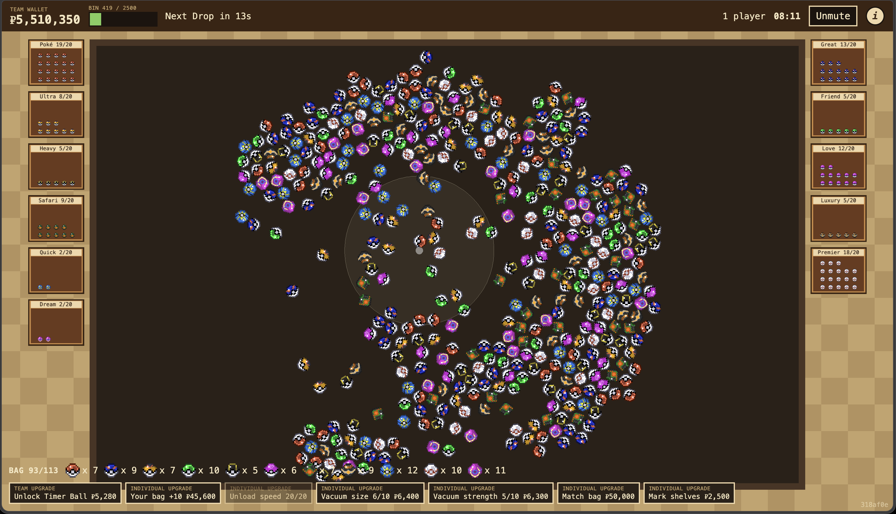

# PokeSort

PokeSort is a cooperative, multiplayer client and server game where players sort Pokeballs into the matching bins. While at least one player is in the game, Pokeballs keep spawning into the central bin. Players can earn team money and upgrade their own skills to vacuum, carry, and sort Pokeballs faster.



The game continues indefinitely, with the goal of keeping the central bin from overflowing. There is no profit motive: PokeSort is a free, open-source project built for fun. All asset sprites are not owned by me.

## How to play

Work together to keep the Pokeballs moving:

- Collect Pokeballs from the central bin.
- Sort them into the bins that match their type.
- Spend team money on shared bonuses.
- Purchase individual upgrades to improve your own carrying capacity, vacuum strength and size, and sorting speed.
- Survive as many spawns as possible. The run ends if too many Pokeballs fill the central bin.

## Project structure

- `client/` - Browser game built with TypeScript and Vite.
- `server/` - Node.js game server that manages sessions, physics, player actions, and snapshots.
- `shared/` - Shared game data and message definitions used by the client and server.

## Development

Install dependencies and start the client and server:

```bash
npm ci --prefix client
npm ci --prefix server
npm run dev
```

The root scripts also support:

```bash
npm run build  # Build the client
npm start      # Start the production server
```

For deployment instructions, see [README_DEPLOY.md](README_DEPLOY.md).
